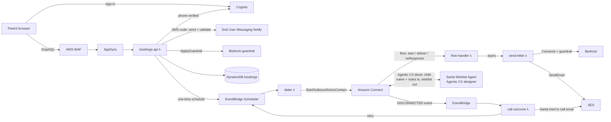

# Santa phone 🎅📞

Parents sign in, verify their mobile by SMS and schedule a call. At that time, Amazon Connect calls
the child and hands the call to Santa, an [Agentic CX designer](https://docs.aws.amazon.com/connect/latest/adminguide/acxd.html)
agent with agentic voice. Santa chats with the child in English and collects their wishlist. The
parents get the wishlist by email, and the booking is deleted.

> **Sample code for controlled demos.** It handles children's names and parents' phone numbers.
> Do not open it to the public without your own legal and privacy review. Sign-up is closed by
> default (see `SIGNUP_ALLOWLIST`).

## Architecture



1. `bookings-api` verifies the parent's mobile with an SMS code that AWS End User Messaging Notify
   generates, sends and validates, and only then marks the phone verified in Cognito. When a call is
   scheduled it takes the phone and email from the verified Cognito attributes, never from the form.
   It checks the notes with the guardrail, takes a slot under the daily call cap, stores the booking
   and creates a one-time schedule.
2. `dialer` places the call. The only contact attribute is `bookingId`.
3. The contact flow `Santa Outbound Call` calls `flow-handler` and the Santa agent:
   - `start` returns the child's name and notes to the flow, which passes them to the agent as
     context variables.
   - `deliver` runs when the agent exits through `DeliverLetter`, with the wishlist, behaviour and
     summary it captured.
   - `noResponse` runs when it exits through `NoConversation` (silence or voicemail).
4. `send-letter` screens the wishes with the guardrail, writes a short letter with Bedrock,
   emails the parent and deletes the booking.
5. `call-outcome` runs on every disconnect:
   - No answer: it retries up to `MAX_CALL_ATTEMPTS` times, `RETRY_DELAY_MINUTES` apart.
   - After the last failed attempt: it emails the parent and deletes the booking.
   - Call cut short mid-conversation: it emails the parent and does not call again.

Decisions are recorded in [`docs/adr`](docs/adr). Third-party licences are in [`THIRD-PARTY-LICENSES`](THIRD-PARTY-LICENSES).

## What is and isn't stored

| Data | Where | How long |
|---|---|---|
| Child name, notes, parent email and phone | DynamoDB | Until the letter or the missed-call email is sent. DynamoDB TTL removes leftovers 2 days after the call time |
| Wishlist | DynamoDB | Seconds, between the end of the call and the email |
| Call audio or transcript | Not stored | Recording and conversational analytics are off |
| Phone number, contact ID, `bookingId` | Connect contact record | 24 months (Connect default, not configurable) |
| Child name and notes, what the child says, Santa's replies | Agentic CX designer conversation history | Designer retention settings; check them before going beyond demos |

## Prerequisites

- Node.js 20 or later, and AWS credentials (`AWS_PROFILE`) for an account that is **not** production.
- A Region with Amazon Connect agentic voice and Agentic CX designer. The sample was tested in
  `eu-central-1` (Frankfurt); US deployments typically use `us-east-1`.

Everything else is created in the steps below. Steps marked **manual** happen in a console or a
Support case and can take from minutes to a few days, so start them early.

## Country

Santa speaks US English. The sample calls US numbers by default; these settings in `.env` change
the country:

| Setting | Default | What it does |
|---|---|---|
| `CALL_TIMEZONE` | `America/New_York` | IANA time zone of the call window and of every date and time parents see |
| `ALLOWED_PHONE_PREFIXES` | `+1` | Comma-separated E.164 prefixes Santa may call. The backend enforces it |
| `GIFT_LINKS_DOMAIN` | `amazon.com` | Store domain for the gift links in the letter, or `off` |
| `NOTIFY_COUNTRIES` | `US` | Countries the verification SMS can go to (`npm run notify:setup`) |

`npm run setup` offers two presets: the United States, and Spain (`Europe/Madrid`, `+34`, `ES`,
`amazon.es`), where the sample was tested.

## Deploy

`npm run setup` asks for the settings, writes `.env`, checks your account (read only) and prints the
manual steps that are still open, with the text of each request filled in. Run `npm run setup -- --check`
at any point to see what is left.

| # | Step | How | Time |
|---|---|---|---|
| 1 | Install | `npm install` | minutes |
| 2 | **Manual:** create an Amazon Connect instance with outbound calls on | Console: Amazon Connect > Add an instance | 2 min |
| 3 | **Manual:** open Agentic CX designer from the instance, note the workspace ID, and create a programmatic user with an API key | Console: your instance > Agentic CX designer > Admin Hub. See [`connect/README.md`](connect/README.md#2a-with-the-script-tested-path) | 5 min |
| 4 | **Manual:** claim a phone number for the caller ID | Connect admin website: Channels > Phone numbers | minutes; local numbers in some countries need documents |
| 5 | **Manual:** allow outbound calls to your country, if the Region does not by default | Support case, see below | 1 to 3 business days |
| 6 | **Manual:** request SES production access | SES console, see below | about a day |
| 7 | Settings | `npm run setup` (sender email, instance ID, number, SMS name, designer workspace ID; the designer API key goes to `.env.local`) | 2 min |
| 8 | Verification SMS | `npm run setup` offers it, or `npm run notify:setup` | 1 min |
| 9 | CDK bootstrap, once per account and Region | `npx cdk bootstrap aws://<account-id>/<region>` | 2 min |
| 10 | First deploy | `npm run sandbox` | 5 min |
| 11 | **Manual:** confirm the sender email | Click the link in the email from Amazon SES | 1 min |
| 12 | Santa agent | `npm run designer:setup`: creates, builds and deploys `Santa Wishlist Agent` from `connect/designer/` | 2 min |
| 13 | Contact flow | `npm run connect:flow` creates and publishes `Santa Outbound Call`, with an agentic voice | 1 min |
| 14 | Web app | `npm run web:deploy`: builds the app and publishes it on Amplify Hosting, prints the URL and saves it as `APP_URL` | 2 min |
| 15 | Second deploy | `npm run sandbox` (picks up the flow ID and `APP_URL`) | 1 min |
| 16 | **Manual:** add parents and admins | Cognito console, see [Add a parent](#add-a-parent) | 1 min each |
| 17 | Test | By chat: [`scripts/santa-chat-test.py`](scripts/santa-chat-test.py); by phone once step 5 is done | |

### Outbound calls to your country (step 5)

New Connect instances can only call some countries. Instances in US East, US West and Canada
call the US, Canada, Mexico, Puerto Rico and the UK; instances in Frankfurt and London call the UK,
Italy, France, Ireland and the US ([full list](https://docs.aws.amazon.com/connect/latest/adminguide/country-code-allow-list.html)).
For any other country, a call fails with `DestinationNotAllowedException` until you ask:

1. Open the [Support form](https://console.aws.amazon.com/support/home#/case/create?issueType=customer-service&serviceCode=service-connect-number-management&categoryCode=country-allowlisting-for-outbound-calls)
   (Account and billing, Service **Connect (Number Management)**, Category **Country Allowlisting for
   Outbound Calls**). Account and billing cases are free on every support plan, but only the console
   opens them: the Support API needs a paid plan.
2. In the description, give the countries, your instance ID, Region and account ID, the caller ID
   and the use case. `npm run setup` prints this text with your values.

### SES production access (step 6)

New accounts are in the SES sandbox: emails only reach addresses you verified in SES, 200 a day.
Until you leave it, verify each parent's address in SES (they get a link) or test with the
[SES mailbox simulator](https://docs.aws.amazon.com/ses/latest/dg/send-an-email-from-console.html#send-email-simulator).

In the SES console choose **Get set up > Request production access** and fill in:
- **Mail type:** Transactional.
- **Website URL:** a public page about your app (your repository or landing page).
- **Use case:** who receives the emails and why (only the signed-in user who booked a call, one
  email per call, no marketing or bought lists), the volume, and how you handle bounces and
  complaints. `npm run setup` prints a suggested text.

AWS usually answers within a day. Prefer a sender on a domain you verify with DKIM over a single
address: it delivers better and it is what the reviewers expect. Once you have production access you
can also send Cognito's invitations and password resets through SES (`COGNITO_EMAIL_VIA_SES=true`);
Cognito's own sender allows 50 emails a day per account.

### Verification SMS (step 8)

Phone verification codes go through [AWS End User Messaging Notify](https://docs.aws.amazon.com/sms-voice/latest/userguide/notify.html),
which sends them from AWS-managed numbers without sender ID or number registration. The setup
creates a Notify configuration for `NOTIFY_COUNTRIES` with the English code template.
Notify reviews the display name automatically: a name that looks like a known brand comes back as
`REQUIRES_VERIFICATION` (it needs a letter of authorization through Support) and cannot send, so
the setup asks for another name. Check that your countries are supported on the
[Notify tier](https://docs.aws.amazon.com/sms-voice/latest/userguide/notify-countries.html) you use.
See [ADR 0006](docs/adr/0006-phone-verification-notify.md).

Bedrock model access needs no request: the account can call Amazon Nova Lite for the letter, through
the cross-Region inference profile of your Region (`us.`, `eu.` or `apac.`, picked from `AWS_REGION`
unless `BEDROCK_MODEL_ID` is set). The Santa agent's models run inside Agentic CX designer.

Until the flow ID is in `.env` (step 15), the dialer refuses to call and the parent gets a
"Santa tried to call" email after the last attempt. 

### Web app (step 14)

`npm run web:deploy` builds the app against the backend in `amplify_outputs.json` and publishes it on
AWS Amplify Hosting as a manual deployment: it creates the Hosting app `WEB_APP_NAME` (default
`santa-call-center`) and its branch `main` the first time, uploads `dist/`, waits for the deployment,
checks that the page loads and saves the URL as `APP_URL`. Run it again after any change to the web
app or to the backend outputs. It needs the `zip` command. The page itself is public, as any sign-in
page is; the API behind it only answers signed-in Cognito users. For local development use
`npm run dev` (`127.0.0.1:5173`).

### Add a parent

Self sign-up is off: only an admin can create users. Create the user in the Cognito user pool with
their email; Cognito emails them a temporary password and a link to `APP_URL`. In the app they
choose a new password and verify their mobile with the SMS code. Santa only calls the phone stored
on the parent's Cognito user, never a number typed in the form.

The user pool ID is `auth.user_pool_id` in `amplify_outputs.json`. Run the commands with the
credentials and `AWS_REGION` you deployed with.

```bash
POOL=$(node -p "require('./amplify_outputs.json').auth.user_pool_id")

# Create the user. The email is their sign-in name; marking it verified lets them schedule calls.
aws cognito-idp admin-create-user --user-pool-id "$POOL" --username parent@example.com \
  --user-attributes Name=email,Value=parent@example.com Name=email_verified,Value=true \
  --desired-delivery-mediums EMAIL

# Optional: make them an admin (Santa's workshop view and the "call in 1 minute" test button).
aws cognito-idp admin-add-user-to-group --user-pool-id "$POOL" --username parent@example.com --group-name ADMINS
```

#### Verify a phone without the SMS code

For a test user, or when the verification SMS can't be delivered (for example while Notify throttles
a number that already got several codes), an admin can save the phone as verified. The app then
skips the SMS step and goes straight to the booking form:

```bash
aws cognito-idp admin-update-user-attributes --user-pool-id "$POOL" --username parent@example.com \
  --user-attributes Name=phone_number,Value=+12125550123 Name=phone_number_verified,Value=true
```

Use E.164 (`+` and the country code, no spaces). The number must still start with one of
`ALLOWED_PHONE_PREFIXES`: the backend checks it again when a call is booked. Only do this for a number
you know belongs to that person. Santa will call it, and the SMS check exists to stop someone from
making Santa call a phone that isn't theirs. To check what is stored:

```bash
aws cognito-idp admin-get-user --user-pool-id "$POOL" --username parent@example.com \
  --query 'UserAttributes[?Name==`phone_number` || Name==`phone_number_verified`]'
```

### Optional: ElevenLabs voice

The sample can speak with an ElevenLabs voice instead of Amazon Connect agentic voice
(`ELEVENLABS_TTS`, off by default). ElevenLabs is a third-party service with its own terms and
pricing, and it receives the text Santa speaks, including the child's first name and wishes. Review
its terms, retention and data residency for your plan before turning it on. See
[ADR 0005](docs/adr/0005-elevenlabs-voice.md) and [`connect/README.md`](connect/README.md#3b-optional-elevenlabs-voice).

### Guardrails

Three guardrails protect the call:
- An Amazon Bedrock guardrail in the backend checks what parents type in the form before it is
  stored, and the letter Bedrock writes.
- `Santa Child Input Guardrail` in Agentic CX designer checks every turn of the child.
- `Santa Reply Output Guardrail` checks every reply from Santa.

Their rules, and why Santa's side relies mostly on the prompt, are in
[`connect/README.md`](connect/README.md#guardrails).

Test the agent by text with [`scripts/santa-chat-test.py`](scripts/santa-chat-test.py) and the
scenarios in [`scripts/chat-scenarios/`](scripts/chat-scenarios/) (see `connect/README.md`, step 5).

## Security

What the sample does, and what you still need before opening it to the public. The threat model is
in [`docs/threat-model.md`](docs/threat-model.md).

| Risk | Control in the sample |
|---|---|
| Someone makes Santa call a number that isn't theirs | The phone must be verified with an SMS code; the backend only calls the phone verified on the parent's Cognito user. Only numbers with the allowed prefixes, `+1` by default (`ALLOWED_PHONE_PREFIXES`) |
| Mass sign-ups | Admin-only user creation by default; optional email/domain allowlist (`SIGNUP_ALLOWLIST`). |
| Cost abuse (calls, SMS, AI) | `MAX_CALLS_PER_DAY` (default 50) across all parents, at most 3 pending calls per parent, a call window, `MAX_SMS_CODES_PER_HOUR` (default 5) per user, Notify only to `NOTIFY_COUNTRIES` |
| Floods and known bad traffic | AWS WAF on the AppSync API: AWS managed rules (IP reputation, common rule set, known bad inputs) and a per-IP rate limit (`WAF_RATE_LIMIT` per 5 minutes) |
| Prompt injection through the notes | 300 characters, brackets and control characters stripped, Bedrock guardrail before storage; designer input guardrail on every child turn |
| Children's data | No recording, no transcript, no child data in Connect contact attributes; the booking is deleted after the email and expires after 2 days |

Before you let people outside your team use it:
- Do your own legal and privacy review. The app processes a child's first name, notes and wishes,
  and the parent's email and mobile. Add a privacy notice and consent that fit your jurisdiction.
- If you turn on ElevenLabs, it processes the text Santa speaks. Use a plan with a data processing
  agreement and the retention you need.
- Set an AWS Budgets alert and Notify spend limits for the account.
- If you open self sign-up, keep email and phone verification on and keep the limits above.
- Turn on MFA in the Cognito user pool, and consider the Cognito Plus tier for threat protection.

### Security scans

```bash
npm run nag      # cdk-nag (AWS Solutions rules) on the synthesized backend; needs no AWS credentials
npm audit --omit=dev
uvx --from git+https://github.com/awslabs/automated-security-helper.git@v3.8.0 ash --mode local
```

Accepted cdk-nag findings are suppressed in [`amplify/nag.ts`](amplify/nag.ts) with the reason for
each, and the reviewed ASH false positives are in [`.ashrc.yaml`](.ashrc.yaml). `npm audit` reports
findings in the Amplify CLI and CDK tooling used to deploy (code generators, `zod`, `minimatch`);
they are not deployed or bundled into the web app, and `npm audit --omit=dev` reports none.

## Develop

```bash
npm test          # unit tests (vitest, AWS SDK mocked)
npm run typecheck
npm run lint
npm run nag       # cdk-nag security checks
```

Setup helpers (Node, AWS SDK; they use your default AWS credentials and `AWS_REGION` from `.env`):

```bash
npm run setup                 # ask for the settings, write .env, list the open manual steps
npm run setup -- --check      # read-only: what is still missing in the account
npm run notify:setup          # create the End User Messaging Notify config for the verification SMS
npm run designer:setup        # create, build and deploy the Santa agent in Agentic CX designer (ACXD_API_KEY)
npm run connect:flow          # fill the flow template and create or update the "Santa Outbound Call" flow
npm run web:deploy            # build the web app and publish it on Amplify Hosting (WEB_APP_NAME)
```

## Cost

Not estimated yet. A 3-minute call adds up outbound telephony to the called country, Agentic CX
designer and agentic voice minutes, Bedrock tokens, one Notify SMS per phone verification and two emails.
AWS WAF adds a monthly charge per web ACL and rule plus requests; set `ENABLE_WAF=false` to skip it.

## Clean up

```bash
npm run sandbox:delete
```

Then delete the Amplify Hosting app (`aws amplify delete-app --app-id <id>`, ID in the Amplify console),
the `Santa Outbound Call` flow and the claimed number in Connect, and the
`Santa Wishlist Agent` application with its two flows and two guardrails in Agentic CX designer.

## License

MIT-0. See [LICENSE](LICENSE).
