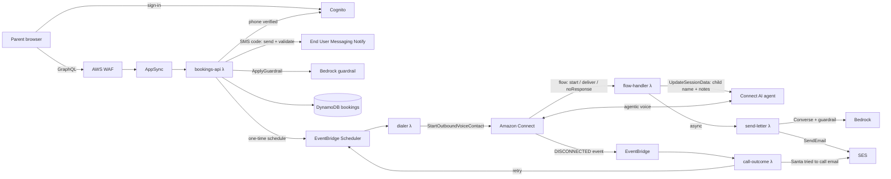

# Santa phone 🎅📞

Parents sign in, verify their mobile by SMS and schedule a call. At that time, an Amazon Connect AI
agent with agentic voice calls as Santa, chats with the child in Spanish and collects their
wishlist. The parents get the wishlist by email, and the booking is deleted.

> **Sample code for controlled demos.** It handles children's names and parents' phone numbers.
> Do not open it to the public without your own legal and privacy review. Sign-up is closed by
> default (see `SIGNUP_ALLOWLIST`).

## Architecture



1. `bookings-api` verifies the parent's mobile with an SMS code that AWS End User Messaging Notify
   generates, sends and validates, and only then marks the phone verified in Cognito. When a call is
   scheduled it takes the phone and email from the verified Cognito attributes, never from the form.
   It checks the notes with the guardrail, takes a slot under the daily call cap, stores the booking
   and creates a one-time schedule.
2. `dialer` places the call. The only contact attribute is `bookingId`.
3. The Connect flow calls `flow-handler`:
   - `start` passes the child's name and notes into the AI agent session.
   - `deliver` runs when the agent invokes the `EntregarCarta` Return to Control tool.
   - `noResponse` covers silence and voicemail.
4. `send-letter` screens the wishes with the guardrail, writes a short letter with Bedrock,
   emails the parent and deletes the booking.
5. `call-outcome` runs on every disconnect:
   - No answer: it retries up to `MAX_CALL_ATTEMPTS` times, `RETRY_DELAY_MINUTES` apart.
   - After the last failed attempt: it emails the parent and deletes the booking.
   - Call cut short mid-conversation: it emails the parent and does not call again.

Decisions are recorded in [`docs/adr`](docs/adr). Third-party licences are in [`THIRD-PARTY-LICENSES`](THIRD-PARTY-LICENSES).

## What is and isn't stored

| Data | Where | How long |
|---|---|---|
| Child name, notes, parent email and phone | DynamoDB | Until the letter or the missed-call email is sent. DynamoDB TTL removes leftovers 2 days after the call time |
| Wishlist | DynamoDB | Seconds, between the end of the call and the email |
| Call audio or transcript | Not stored | Recording and conversational analytics are off |
| Phone number, contact ID, `bookingId` | Connect contact record | 24 months (Connect default, not configurable) |
| Child name and notes | Connect AI agent session | Retention not documented by this sample; check before going beyond demos |

## Prerequisites

- Node.js 20 or later, and AWS credentials for an account that is not production.
- An Amazon Connect instance in a Region with agentic voice. This sample uses `eu-central-1`.
- SES is in sandbox mode in new accounts: verify every recipient email in SES, or request production access.
  Once SES has production access you can also send Cognito's invitations and password resets through it
  (`COGNITO_EMAIL_VIA_SES=true`); Cognito's default sender allows 50 emails a day per account.
- Phone verification SMS go through [AWS End User Messaging Notify](https://docs.aws.amazon.com/sms-voice/latest/userguide/notify.html),
  which sends one-time codes from AWS-managed numbers without a sender ID or number registration.
  Spain is on the Notify Basic tier. Create the two Notify resources once with `npm run notify:setup`
  (AWS CLI 2.40 or later) and paste the two lines it prints into `.env`. See
  [ADR 0006](docs/adr/0006-phone-verification-notify.md).

## Deploy

```bash
npm install
cp .env.example .env   # set CONNECT_INSTANCE_ID, SANTA_SENDER_EMAIL, SIGNUP_ALLOWLIST
npm run notify:setup   # once; paste the NOTIFY_* lines into .env
npm run sandbox        # first deploy; confirm the SES verification email you receive
```

Then follow [`connect/README.md`](connect/README.md) to create the AI agent, bot and flow. Put
the flow ID, caller ID and assistant ID in `.env` and run `npm run sandbox` again. Until the flow
ID is set, the dialer refuses to call and the parent gets a "Santa tried to call" email after the
last attempt.

Run the web app locally with `npm run dev`. For hosting, connect the repo to Amplify Hosting.

### Add a parent

Self sign-up is off: only an admin can create users. Create the user in the Cognito user pool with
their email. They verify their mobile with the SMS code in the app. For a test user you can also set
the phone yourself:

```bash
aws cognito-idp admin-update-user-attributes --user-pool-id <pool-id> --username <username> \
  --user-attributes Name=phone_number,Value=+34XXXXXXXXX Name=phone_number_verified,Value=true
```

Santa only calls the phone stored on the parent's Cognito user, never a number typed in the form.

### Optional: ElevenLabs voice

The sample can speak with an ElevenLabs voice instead of Amazon Connect agentic voice
(`ELEVENLABS_TTS`, off by default). ElevenLabs is a third-party service with its own terms and
pricing, and it receives the text Santa speaks, including the child's first name and wishes. Review
its terms, retention and data residency for your plan before turning it on. See
[ADR 0005](docs/adr/0005-elevenlabs-voice.md) and [`connect/README.md`](connect/README.md#4b-optional-elevenlabs-voice).

### Guardrails

Two Amazon Bedrock guardrails protect the call:
- The backend guardrail checks what parents type in the form before it is stored.
- The Amazon Connect AI guardrail checks every turn of the child. Its settings, and why Santa's
  side is left to the prompt, are in [`connect/agent-guardrail.md`](connect/agent-guardrail.md).

Test the AI agent by text with [`scripts/santa-chat-test.py`](scripts/santa-chat-test.py) and the
scenarios in [`scripts/chat-scenarios/`](scripts/chat-scenarios/) (see `connect/README.md`, step 6).

## Security

What the sample does, and what you still need before opening it to the public. The threat model is
in [`docs/threat-model.md`](docs/threat-model.md).

| Risk | Control in the sample |
|---|---|
| Someone makes Santa call a number that isn't theirs | The phone must be verified with an SMS code; the backend only calls the phone verified on the parent's Cognito user. `+34` mobiles only (`ALLOWED_PHONE_PREFIXES`) |
| Mass sign-ups | Admin-only user creation by default; optional email/domain allowlist (`SIGNUP_ALLOWLIST`). |
| Cost abuse (calls, SMS, AI) | `MAX_CALLS_PER_DAY` (default 50) across all parents, at most 3 pending calls per parent, a call window, `MAX_SMS_CODES_PER_HOUR` (default 5) per user, Notify only to Spain |
| Floods and known bad traffic | AWS WAF on the AppSync API: AWS managed rules (IP reputation, common rule set, known bad inputs) and a per-IP rate limit (`WAF_RATE_LIMIT` per 5 minutes) |
| Prompt injection through the notes | 300 characters, brackets and control characters stripped, Bedrock guardrail before storage; Connect AI guardrail on every child turn |
| Children's data | No recording, no transcript, no child data in Connect contact attributes; the booking is deleted after the email and expires after 2 days |

Before you let people outside your team use it:
- Do your own legal and privacy review. The app processes a child's first name, notes and wishes,
  and the parent's email and mobile. Add a privacy notice and consent that fit your jurisdiction.
- If you turn on ElevenLabs, it processes the text Santa speaks. Use a plan with a data processing
  agreement and the retention you need.
- Set an AWS Budgets alert and Notify spend limits for the account.
- If you open self sign-up, keep email and phone verification on and keep the limits above.
- Turn on MFA in the Cognito user pool, and consider the Cognito Plus tier for threat protection.

### Security scans

```bash
npm run nag      # cdk-nag (AWS Solutions rules) on the synthesized backend; needs no AWS credentials
npm audit --omit=dev
uvx --from git+https://github.com/awslabs/automated-security-helper.git@v3.8.0 ash --mode local
```

Accepted cdk-nag findings are suppressed in [`amplify/nag.ts`](amplify/nag.ts) with the reason for
each, and the reviewed ASH false positives are in [`.ashrc.yaml`](.ashrc.yaml). `npm audit` reports
findings in the Amplify CLI and CDK tooling used to deploy (code generators, `zod`, `minimatch`);
they are not deployed or bundled into the web app, and `npm audit --omit=dev` reports none.

## Develop

```bash
npm test          # unit tests (vitest, AWS SDK mocked)
npm run typecheck
npm run lint
npm run nag       # cdk-nag security checks
```

## Cost

Not estimated yet. A 3-minute call adds up outbound telephony to Spanish mobiles, Connect AI
agent and voice minutes, Bedrock tokens, one Notify SMS per phone verification and two emails.
AWS WAF adds a monthly charge per web ACL and rule plus requests; set `ENABLE_WAF=false` to skip it.

## Clean up

```bash
npm run sandbox:delete
```

Then delete the flow, bot, AI agent and claimed number in Connect.

## License

MIT-0. See [LICENSE](LICENSE).
